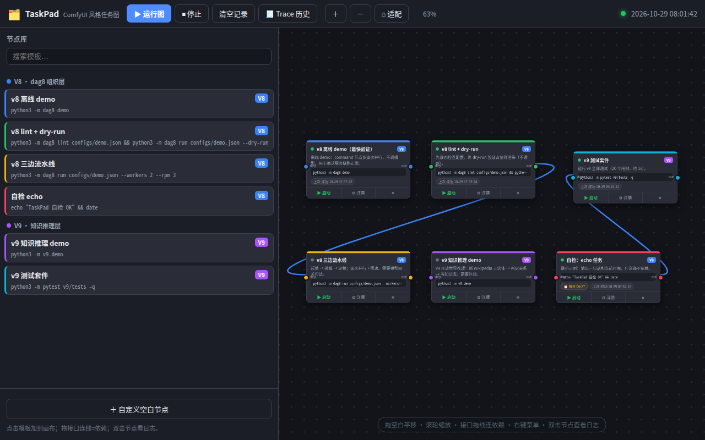

# TaskPad · 任务白板（ComfyUI 风格节点图）

一个**零依赖**的 Node.js 全栈应用，界面模仿 **ComfyUI** 的节点图。

## Agent 工位（网页互动接任务）

工具栏「🤝 接任务」：填节点名 → 认领任务 → 查看模块/接口契约与上游输入（文本预览 / 文件下载）→
本地执行 `run.command` → 上传成果文件（文件型输出接口）→ 勾选接口测试 → 填 stdout/stderr/exitCode → 提交。
提交后结果即时写回图与运行记录；同一套流程也可用 `curl`（见 `/agent.md`）或 `worker.py`。

## 数据模型：项目 → 模块 → 接口 → 流程图

```
图 Graph（2D 画布，绝对坐标）
 ├─ 节点 Node  ← 定义 agent 的「工作范围 scope」+「工作规范 spec」（作业契约）
 │    └─ 内部流程图（子图，可继续嵌套）
 └─ 边 Edge   ← 规定上游输出接口 → 下游输入接口之间的「接口契约 contract」
      └─ 接口（端口）：每个端口有「规范 spec」+「接口测试 tests」
```

- **图**：节点和边的绝对位置、拓扑关系全部保存在 server（`data/store.json`）
- **节点**：`scope` 规定 agent 可操作范围，`spec` 规定作业要求；节点可打开自己的**内部流程图**（子图，递归嵌套），面包屑导航
- **边**：`contract` 描述这条连线要求满足什么（格式/约束）
- **接口测试**：每个输入/输出端口可配多条测试（shell 命令，agent 执行，`exit 0` = 通过）
  - 输入端口被测数据：`$__INPUT`（文本）/ `$__INPUT_FILE`（文件路径）
  - 输出端口被测数据：`$__RESULT`（文本）/ `$__RESULT_FILE`（文件路径）
  - **上游成果未通过输出接口测试 → 该运行标记失败，成果不投递给下游**
  - **下游输入接口测试不通过 → 下游任务不执行，直接报错**
  - 测试由 agent 执行，结果随 submit 一起上传到 server 落库

> **架构：网站只做「调度 + 存储」，不执行任何命令。**
> 节点（worker）从网站**拉取**待认领任务、在各自机器上执行，跑完把 stdout/成果文件**上传**回网站。
> 网站负责：任务/端口/连线、运行队列（待认领 → 执行中 → 完成）、成果存储、定时、trace 历史。

```
浏览器 ──编辑/运行图──▶ 网站(server.js) ──pending 运行──▶ 节点(worker.py) 拉取
                              ▲                                  │ 本地执行
                              └────── submit：stdout/退出码/成果文件 ◀┘
网站落库：运行记录 + trace + 成果存储（data/artifacts/）
下游节点认领时，从网站拉取上游成果（文本内联 / 文件下载）
```

- 无线画布：拖空白平移、滚轮缩放、节点可拖动（鼠标 / 触摸 / 双指缩放）
- **多输入/输出端口，端点可拖拽**：每个节点可配任意多个命名端口；从输出口拖到输入口拉贝塞尔曲线 = 数据流连线（可用鼠标拖拽任意端口）
- **数据流与成果**：连线 = 上游输出端口 → 下游输入端口；运行结束后自动捕获各输出端口的“成果”（stdout 文本 或 目录 glob 匹配的文件）
- **下游真正拿到上游数据**：注入环境变量 `$__IN_<端口名>`（文本成果）与 `$__IN_<端口名>_FILE`（文件产物路径），下游命令直接读取
- **成果卡片**：任务面板按输出端口展示最近成功运行的成果卡（文本预览 / 文件下载）；**点击一条连线弹出“这条线传的成果”卡片**
- 左侧**节点库**：模板一键加入画布（V8 dag8 任务 / V9 知识推理任务），可搜索
- 工具栏 **▶ 运行图**：按连线方向（拓扑排序）依次执行整张图，带运行进度与队列指示
- 节点可单独 ▶ 启动；右键菜单：运行 / 编辑 / 复制 / 删除
- **定时任务**（间隔 / 每日 / cron）与**实时运行日志**（SSE + 轮询双保险）
- **🧾 Trace 历史**：每次执行（手动 / 定时 / 运行图）自动记录为一条 trace，可回看执行顺序、每步状态与完整输出

> 示例数据流：`自检：echo 任务 [out] → v9 测试套件 [dep]`（先跑前置任务）



### 交互快捷键

| 操作 | 方式 |
|---|---|
| 平移画布 | 拖拽空白处 / 滚轮缩放 / 触屏双指平移 |
| 移动节点 | 拖动节点任意位置（鼠标 / 触摸均可） |
| 建立数据流 | 拖 输出口 → 输入口（可拖任意端口、可多端口） |
| 断开连线 | 双击连线 / 右键连线 → 删除 / Delete 键 |
| 看线传的成果 | 单击连线弹出“成果卡”（上游最近成果预览） |
| 管理端口 | 双击节点 → “端口”区：增删端口、改名、选捕获方式 |
| 查看详情 | 双击节点（端口、成果卡、定时、日志、编辑） |
| 复制节点 | 选中后 Ctrl+D 或右键 |
| 新建节点 | 左侧节点库 或 右键画布 |
| 历史 Trace | 工具栏「🧾 Trace 历史」 |

## 部署（server 与 agent 分离）

**server**（调度 + 存储）不执行任何命令，部署在任意有 Node.js 的机器（VPS / 树莓派 / Termux 手机）：

```bash
git clone https://github.com/Hana-ame/agent.git
cd agent/taskpad
node server.js
# 生产守护：
#   Linux      → systemd / pm2 / nohup
#   Termux     → termux-services（runsv 守护，sv-enable taskpad），可参考下方脚本
```

**agent**（真正执行任务的节点）跑在其它机器上，可多台并行抢任务：

```bash
python3 worker.py --server http://<server>:8330 --worker-id <节点名> --root <项目路径>
```

> `data/` 不进 git；首次启动自动 seed 演示任务。节点通过 `--server` 指向网站地址即可，与 server 无需共享文件系统。

## 快速开始

```bash
# 终端 1：启动网站（调度 + 存储中枢）
cd taskpad
node server.js        # 等价于 npm start

# 终端 2：启动节点（执行器，可多开/部署到别的机器）
python3 worker.py --server http://127.0.0.1:8330 --worker-id my-node --root /path/to/你的项目
```

然后浏览器打开 **http://127.0.0.1:8330**，点节点 ▶ 启动 或工具栏「▶ 运行图」。网站把任务标记为
**待认领**，节点在几秒内认领执行并把输出/成果上传回来；页面显示 `🖥 节点 N` 与运行状态。

节点参数：

| 参数 | 说明 |
|---|---|
| `--server` | 网站地址（默认 `http://127.0.0.1:8330`） |
| `--worker-id` | 节点名（默认主机名），显示在运行记录里 |
| `--root` | 命令的相对执行根目录（v8 任务会在 `--root/v8` 下跑） |
| `--interval` / `--heartbeat` | 空闲轮询间隔 / 心跳间隔秒 |
| `--once` | 只跑一个任务后退出（调试用） |

> 节点只依赖 Python 标准库；可部署到任意能访问网站的机器（`--server` 指网站地址）。

预置了 6 个可直接运行的任务示例（来自工作区 v7/v8/v9 项目）：

| 节点 | 引擎 | 命令（可改） |
|---|---|---|
| v8 离线 demo | V8 | `python3 -m dag8 demo` |
| v8 lint + dry-run | V8 | `python3 -m dag8 lint configs/demo.json && python3 -m dag8 run configs/demo.json --dry-run` |
| v8 三边流水线 | V8 | `python3 -m dag8 run configs/demo.json --workers 2 --rpm 3` |
| v9 知识推理 demo | V9 | `python3 -m v9.demo` |
| v9 测试套件 | V9 | `python3 -m pytest v9/tests -q` |
| 自检：echo 任务 | V8 | `echo "TaskPad 自检 OK" && date` |

## 用法

- **运行图**：点工具栏「▶ 运行图」按依赖顺序依次执行全部节点（有依赖环也会输出顺序并在提示中说明）；「⏹ 停止」清空队列并终止当前任务。
- **依赖连线**：每个节点左侧 `dep` 输入口、右侧 `out` 输出口。连线 = 下游依赖上游，「运行图」时先跑上游。
- **启动单个任务**：点节点上的 ▶ 启动 → 网站生成「待认领」运行；节点认领后执行，完成后显示成功/失败与输出（stderr 红色）。页面右上 `🖥 节点 N` 显示在线节点数。
- **V8 / V9 引擎**：新建/编辑任务时选择引擎。引擎决定**工作目录**与运行环境（见下）。
- **定时任务**：双击节点 → 面板「⏰ 定时任务」→ 新建定时：
  - 间隔：每 N 分钟
  - 每日：每天 HH:MM
  - cron：标准 5 段表达式（`分 时 日 月 周`），如 `0 * * * *`、`*/5 * * * *`
  - 定时触发时若该任务正在运行，本次会记为「跳过」，不会并发跑。
- **Trace 历史**：`🧾 Trace 历史` 弹窗按时间倒序列出每次执行；点开可看执行步骤顺序、每步状态/耗时、执行该步的节点，点任意步骤展开完整输出。
- **失联恢复**：节点执行中若心跳超时（默认 90s），网站会把运行放回「待认领」，由其它节点接管。
- 数据持久化在 `taskpad/data/store.json`（任务 / 定时 / 运行 / trace），重启不丢失。

## 引擎配置（config.json）

```jsonc
{
  "port": 8330,
  "root": "..",              // 项目根（相对 taskpad 目录）；命令默认以此为准
  "engines": {
    "v8": { "label": "V8 · dag8 组织层", "cwd": "v8",  "env": { "TASK_ENGINE": "v8" }, "timeoutMs": 1800000, "color": "#3b82f6" },
    "v9": { "label": "V9 · 知识推理层", "cwd": ".",  "env": { "TASK_ENGINE": "v9" }, "timeoutMs": 1800000, "color": "#a855f7" }
  }
}
```

- `cwd`：该引擎下任务命令的运行目录，相对 `root`。V8 在 `v8/` 里跑（`dag8` 包只有那里可导入），V9 在项目根跑。
- 想新增引擎（如 v7、v127）：照抄一段并起个 id 即可，前端会自动出现选项。
- **Windows 注意**：当前命令用 `python3`（WSL/Linux）。在 Windows 上把命令里的 `python3` 换成 `python` 或 `.venv\Scripts\python.exe`；shell 语法（`&&`、`for` 等）按 cmd/PowerShell 调整。

## 常见问题

- **任务启动失败 / 找不到 python**：确认命令在你的运行环境（WSL 或 Windows）可用；改任务的「执行命令」即可。
- **想换端口**：改 `config.json` 的 `port`。
- **node_modules 在哪**：没有，纯 Node.js 内置模块，无需安装。
- **清空数据**：删除 `taskpad/data/store.json` 后重启，会重新生成示例任务。

## REST API 一览

```
GET    /api/state                    全部状态（任务/定时/最近运行/引擎/队列/traces/workers）
POST   /api/runs/claim               节点认领一个待认领运行 {workerId}（返回命令/上游输入/输出端口）
POST   /api/runs/:id/heartbeat       节点心跳 {workerId}（响应 abort=true 表示应终止）
POST   /api/runs/:id/submit          节点上报结果 {workerId, exitCode, stdout, stderr, aborted}
POST   /api/runs/:id/files/<name>    节点上传成果文件（原始字节）
POST   /api/runs/:id/kill            中止运行（待认领直接中止；执行中通知节点停止）
GET    /api/templates                节点库模板列表
GET    /api/state                    状态（graphs / tasks / edges / runs / traces / workers）
POST   /api/graphs                   新建图 {name, parentNodeId?}（parentNodeId = 节点内部流程图）
POST   /api/graphs/:id               重命名图 {name}
DELETE /api/graphs/:id               删除图（含子图与节点）
POST   /api/edges/:id                更新边契约 {contract}
# 节点/端口保存：POST /api/tasks/:id { scope, spec, inputs:[{name,spec,tests}], outputs:[{name,spec,tests,capture,glob}] }
# 认领返回：节点 scope/spec、输入接口 spec/tests/contract、上游数据、输出接口 spec/tests
# submit 上报：{ exitCode, stdout, stderr, aborted, files, tests:[{portId,side,testId,name,passed,exitCode,output}] }
POST   /api/edges                    新建数据流连线 {from, fromPort, to, toPort}
DELETE /api/edges/:id                删除连线
GET    /api/runs/:id/file?portId=    下载文件型成果
POST   /api/graph/run                运行图（按依赖拓扑排序入队，串行执行）
POST   /api/graph/stop               停止队列并终止当前任务
GET    /api/traces                   历史 trace 列表
GET    /api/traces/:id               单条 trace 详情（有序步骤+状态）
POST   /api/tasks                    新建任务
POST   /api/tasks/:id                更新任务（含画布位置 x/y）
DELETE /api/tasks/:id                删除任务（连带其定时）
POST   /api/tasks/:id/run            立即启动（手动）
GET    /api/runs                    最近运行
GET    /api/runs/:id                 单次运行全量输出
POST   /api/runs/:id/kill            终止运行中的任务
POST   /api/runs/clear               清空运行记录
POST   /api/schedules                新建定时 {taskId,type,minutes,time,cron,enabled}
POST   /api/schedules/:id            更新/启停定时
DELETE /api/schedules/:id            删除定时
GET    /api/events                   SSE 实时事件（state / run:start / run:output / run:end）
```

> ⚠️ 安全提示：本应用会以当前用户权限在本机 shell 里执行任务命令，**仅限本机/内网使用**，勿公网暴露。